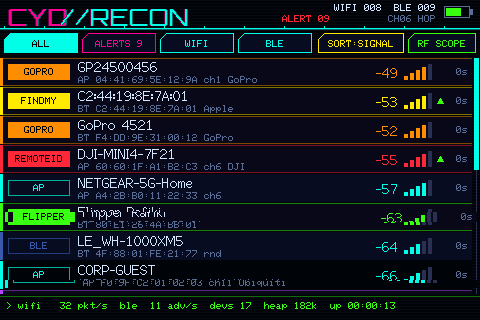
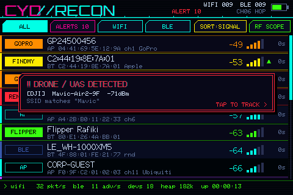
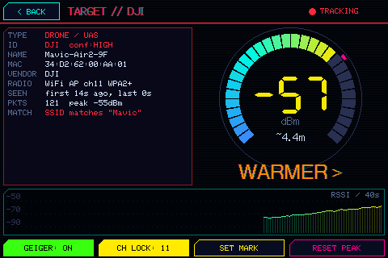
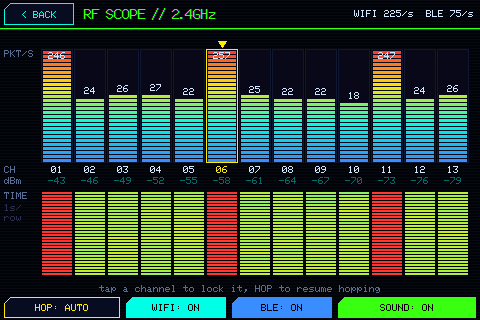

# CYD//RECON

Passive radio recon firmware for the **Freenove ESP32-S3 Display 3.5"** (FNK0104N: ST77922 320×480 QSPI panel, capacitive touch, ES8311 speaker). It shows the WiFi and Bluetooth devices around you, flags the ones worth knowing about, and helps you find them with a hot/cold tracker. The UI has a neon, cyberpunk terminal look.

| Device list | New-threat alert |
|---|---|
|  |  |
| **Target tracker** | **RF scope** |
|  |  |

*(Screenshots rendered by `tools/preview` with simulated devices.)*

> **Receive-only.** The firmware never transmits a frame, never associates and never connects to anything. BLE scanning is passive.

## Features

- **Live device list:** WiFi APs, WiFi clients (including the SSIDs they probe for) and BLE advertisers. You can filter (ALL / ALERTS / WIFI / BLE) and sort (signal / newest / threat). Drag to scroll and tap a row to open it.
- **Recognised devices** (flagged with a coloured badge, an alert pop-up, a chirp and an LED flash):

| Category | Examples | How |
|---|---|---|
| Drones | DJI, Parrot, Skydio, Autel, Tello, toy FPV drones, **any drone broadcasting Remote ID** | OUI, SSID, ASTM F3411 Remote ID (WiFi beacon + NAN + BLE), decoded for serial number, drone position and altitude, and pilot position |
| Cameras | GoPro, Insta360, DJI Osmo, dashcams, Ring/Wyze setup APs | OUI, `GPxxxxxxxx` SSIDs, GoPro BLE service `FEA6`, BLE company ID `0x02F2` |
| Surveillance | **Flock Safety** ALPR cameras and Penguin battery packs, Raven, Axon body cams, ShotSpotter | SSID keywords, BLE names, company ID `0x09C8`, Raven service UUIDs, Flock OUIs |
| Tracking tags | **AirTag / Apple Find My** (separated mode), Tile, Samsung SmartTag, Chipolo, Google Find My Device tags, Pebblebee | Apple Find My payload type `0x12`, service UUIDs `FEED`/`FEEC`/`FD5A`/`FE33`, FMDN frames |
| Camera glasses | Meta Ray-Ban, Snap Spectacles | BLE company IDs, Meta service `FD5F`, names |
| Hack tools | Flipper Zero, WiFi Pineapple, ESP32 Marauder, pwnagotchi | BLE services `3081`–`3083`, OUI, SSID |

- **Target tracker:** tap any device to open the tracker. It shows:
  - a segmented RSSI gauge with peak marker and a rough distance estimate
  - a **WARMER / COOLER / HOTTER / COLDER** verdict from fast and slow RSSI averages
  - a 40-second RSSI graph and a **MARK** button: set it where you're standing, then walk and compare against it
  - a **Geiger-counter** audio ticker whose rate and pitch rise as you get closer, with the RGB LED pulsing from blue to red
  - WiFi targets automatically lock the sniffer to the target's channel for fast updates
  - all decoded details: vendor, MAC (randomised or not), channel and security, probe requests, raw BLE advertisement hex, match reason, and Remote ID coordinates
- **RF scope:** packets per second for each 2.4 GHz channel, strongest RSSI per channel, and a waterfall. Tap a channel to park on it.
- **Battery gauge** on every screen:
  - The cell icon shows 4 segments plus a percentage, mapped from a LiPo discharge curve rather than a straight line.
  - It shows a bolt while charging, `FULL` at the charge ceiling, and `USB PWR` when no cell is fitted.
  - You get a one-off banner, chirp and LED flash at 15% and again at 5%.
  - The live voltage appears in the bottom status ticker.
- Alerts are also printed over USB serial as CSV: `[ALERT] category,label,mac,rssi,reason`.

## Build and flash

You need [PlatformIO](https://platformio.org/) (CLI or the VS Code extension).

```bash
pio run -t upload
```

```bash
pio device monitor
```

**No toolchain?** A prebuilt image is in `release/`. Flash it at offset 0 with [esptool](https://github.com/espressif/esptool), or with the web flasher at https://espressif.github.io/esptool-js/:

```bash
esptool --chip esp32s3 write-flash 0x0 release/cyd-recon-fnk0104n-full.bin
```

The project uses the [pioarduino](https://github.com/pioarduino/platform-espressif32) platform (Arduino-ESP32 3.x / ESP-IDF 5.x), board settings for 16 MB flash and 8 MB OPI PSRAM, and the `huge_app` partition table. If the upload doesn't start, hold **BOOT**, tap **RST**, release BOOT, and try again.

## Controls

| Where | Action |
|---|---|
| List | Tap a tab to filter, tap SORT to cycle the sort order, drag to scroll, tap a row to track it |
| Alert pop-up | Tap it to jump straight into tracking that device |
| Tracker | GEIGER on/off, CH LOCK (WiFi), SET/CLEAR MARK, RESET PEAK |
| Anywhere | **BOOT** button or the `< BACK` button returns to the list |

## Hunting tips

- RSSI is noisy. Move slowly, pause for a second or two at each spot, and trust the trend more than any single number.
- Your body blocks 2.4 GHz. Turn on the spot: the direction where the signal is weakest is usually behind you.
- Set a MARK, take 5–10 steps, and check the `vs MARK` delta. A gain of more than 6 dB means you're going the right way.
- AirTags and other trackers rotate their BLE address about every 15 minutes, and phones randomise WiFi MACs, so a "new" device may be an old one under a new address.

## Limitations

- The ESP32-S3 radio is **2.4 GHz only**. 5.8 GHz video links (most DJI OcuSync/O4, analog FPV) are invisible to it. DJI drones are still caught by their Remote ID broadcast, by 2.4 GHz WiFi models, or by their controllers' WiFi.
- Detection is signature-based, so there can be false positives and misses. Flock OUI-only matches are shown as `FLOCK?` at medium confidence because several of those prefixes are shared with generic WiFi modules. Low-confidence matches keep their badge with a `?` but don't trigger alerts.
- The distance estimate uses a generic path-loss model. Treat it as a hint, not a measurement.

## Code layout

```
src/
  main.cpp        boot sequence + main loop
  config.h        FNK0104N pin map and tuning knobs
  display.*       ST77922 QSPI driver (double-buffered DMA, landscape rotation)
  touch.*         I2C touch controller
  audio.*         ES8311 codec + synth task (blips, alert chirp, Geiger ticker)
  led.*           WS2812 status LED
  radio.*         WiFi promiscuous sniffer, channel hopper, BLE observer, Remote ID decoder
  devices.*       device table, RSSI smoothing, filters and sorting
  signatures.*    fingerprint database + classifier (add your own signatures here)
  ui.*            all screens
tools/preview/    desktop harness that renders the real UI with fake data to PNG
```

To add a signature, append to the relevant table in `src/signatures.cpp` (`kOui`, `kSsid`, `kBleName`, `kCompany`, `kUuid`).

To preview UI changes without hardware, run `pio run` once (it fetches the libraries), then:

```bash
tools/preview/run.sh
```

## Legal

Passive reception of broadcast radio is legal in most places, but laws differ. Don't use this to stalk or harass anyone. Finding a tracker that someone planted on *you* is exactly what it's for. See `NOTICE` for third-party data credits.
